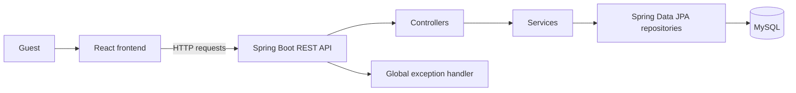
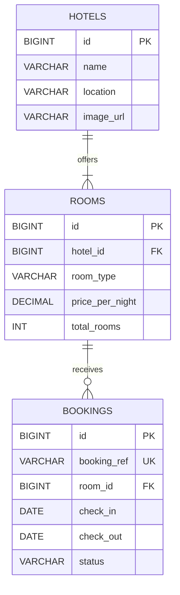

## Architecture

I built the frontend with React and Vite. It sends HTTP requests through Axios to the Spring Boot API, and the backend reads and writes hotel and booking data in MySQL.

The controller layer receives requests and returns response DTOs. The service layer contains the booking, date, availability, and search rules. Repositories use Spring Data JPA to read and write entities. The global exception handler turns known exceptions and request errors into the same JSON error structure.

I allow browser requests from `http://localhost:5173` to `/api/**` using CORS. I did not find a frontend `.env` file or environment-based API URL: the Axios base URL is currently `http://localhost:8080/api` in `frontend/src/api/api.js`. The backend database URL is in `application.properties`, while its username and password come from `DB_USER` and `DB_PASSWORD` environment variables.

## Database design

The `hotels` table stores hotel details, amenities, and an image path. A hotel can have several rows in `rooms`, with one row for each room type and its price and inventory count. Each `bookings` row points to one room-type row, so a booking reserves one room type for one date range.

The database uses foreign keys from rooms to hotels and bookings to rooms. `booking_ref` is unique. Check constraints require positive room prices and room counts, a check-out date after check-in, and a status of `CONFIRMED` or `CANCELLED`. There is an index on `(room_id, check_in, check_out)` to support room/date overlap lookups.

I compute availability from overlapping `CONFIRMED` bookings rather than storing a changing availability counter. This avoids having a separate counter to update when a booking is created or cancelled. The inventory count remains on each room type as `total_rooms`; the number left is calculated for the requested dates.

## API design

All endpoints are under `/api`. The API returns DTOs instead of exposing JPA entities.

| Method | URL | Purpose | Main success status | Main error statuses |
|---|---|---|---|---|
| GET | `/api/health` | Check that the backend is running. | 200 | — |
| GET | `/api/hotels?location=&checkIn=&checkOut=` | Search hotels and calculate availability for the dates when supplied. | 200 | 400 for invalid or incomplete dates. |
| GET | `/api/hotels/{id}?checkIn=&checkOut=` | Get one hotel's details and room availability. | 200 | 400 for invalid dates; 404 if the hotel is missing. |
| POST | `/api/bookings/quote` | Calculate a quote for one room type and date range. | 200 | 400 for validation/date errors; 404 if the room is missing. |
| POST | `/api/bookings` | Create a booking for one room type. | 201 | 400 for validation/date errors; 404 if the room is missing; 409 if sold out. |
| GET | `/api/bookings/{ref}?email=` | Retrieve a booking using its reference and guest email. | 200 | 400 if email is missing; 404 if the pair does not match. |
| PUT | `/api/bookings/{ref}/cancel?email=` | Cancel a booking using its reference and guest email. | 200 | 400 if cancellation is not allowed; 404 if the pair does not match. |

The global exception handler uses one error response shape: `status`, `error`, `message`, and `timestamp`. It maps bad requests to 400, missing records to 404, and sold-out bookings to 409. Other unexpected exceptions return a generic 500 response.

## Booking logic

I calculate nights as the number of days between check-in and check-out. The backend multiplies nights by the selected room type's `pricePerNight` using `BigDecimal`; it does not trust a total sent by the browser. The quote endpoint also returns the current availability for that room and date range.

The shared `DateValidator` requires check-out to be after check-in and does not allow check-in in the past. Check-in today is allowed. Search can omit both dates to show hotels without date-specific availability; if only one date is supplied, it returns a bad request.

Two stays overlap when the existing check-in is before the requested check-out and the existing check-out is after the requested check-in. For example, if one booking is from June 10 to June 12, a stay beginning June 12 is allowed: the first guest checks out on the day the next guest checks in.

Availability is counted separately for each room-type row. The service subtracts overlapping confirmed bookings from that row's `total_rooms`, with a minimum result of zero. A hotel is available if at least one of its room types has rooms left. Cancelled bookings do not consume availability because the repository query counts only `CONFIRMED` bookings.

For a new booking, the backend creates a reference in the form `HB-` plus eight uppercase letters or digits derived from a UUID. It checks for a duplicate before saving and tries again if needed. It trims the guest name and trims and lowercases the guest email.

Retrieval and cancellation look up a booking by both the uppercased reference and lowercased email. A wrong reference and a wrong email produce the same 404 message: `Booking not found. Please check your reference and email`.

Cancellation changes the booking status to `CANCELLED` and saves the same row. It is rejected if it is already cancelled or if check-in is before today. Check-in on today is not considered past. Since availability counts only confirmed bookings, the cancellation releases the room for that date range without changing the room row.

## Design decisions

I calculate availability from bookings instead of storing an availability counter. This avoids counter drift when bookings are cancelled, but it means each search needs overlap counts from the database.

I count overlapping bookings instead of creating a per-night inventory table. This keeps the schema smaller and supports the current room-type inventory model. A per-night table could make busy inventory queries more direct, but it would add rows and booking logic for every night in a stay.

I return DTOs from controllers instead of entities. This gives each endpoint a clear response shape and avoids exposing database relationships, though DTO fields need to be maintained alongside the API.

I store one room row per room type with a `total_rooms` count. It is simpler than representing every physical room separately, but the application does not track room numbers or assign a specific physical room to a guest.

I store booking status as a `VARCHAR` in SQL and map it to the Java `BookingStatus` enum. The SQL check constraint limits allowed values. This avoids a database-specific `ENUM`, while still keeping status values controlled in the application and database.

I run MySQL in Docker for local development. This makes the database setup repeatable without installing MySQL directly on the development machine, but Docker must be running when using the real backend database.

I use React component state for the current page's forms, results, and messages instead of adding Redux. The application currently has a small number of pages and local state is straightforward; shared or complex state could make a store useful later.

## Simultaneous bookings

`BookingService.createBooking` runs inside one `@Transactional` method. It first loads and pessimistically locks the selected room row through `RoomRepository.findByIdForUpdate`. It then validates the dates, counts overlapping confirmed bookings, compares that count with the room type's capacity, and saves the booking if a room remains.

Requests for the same room row are serialized by that database lock. After the first booking commits, the next request should see the updated overlapping count; if that count has reached `total_rooms`, the service throws `SoldOutException`, which becomes HTTP 409. The current tests cover the sold-out calculation and the real overlap query, but they do not run two booking requests concurrently. I have not verified this behavior under concurrent load.

With more time, I could add a version column with optimistic locking, a per-night inventory table, or a retry policy for transient lock conflicts. Those approaches may be useful with multiple application servers or high traffic, but the current implementation has not been tested at that scale.

## Surprise feature

I added the Best Deal badge to make a low-priced available hotel easier to notice. The hotel service finds the lowest `startingPrice` among available hotels and marks every available hotel tied at that price. Sold-out hotels never receive the badge. A hotel's starting price is the lowest price among its available room types; if none are available, the response still has a starting price but is excluded from the Best Deal comparison. The individual hotel details endpoint does not run the search comparison, so its `bestDeal` field remains false.

## Limitations and improvements

- I have not added login, user accounts, or role-based access.
- I have not added payment processing or email confirmation.
- Search does not have pagination.
- I use SQL scripts for initial setup and upgrades; I have not added a migration tool such as Flyway.
- I have not added frontend tests or end-to-end tests.
- I have not added a concurrency test for simultaneous booking requests. The existing automated tests cover date rules, service logic, Best Deal behavior, and the real overlap query using a test database.
- Availability is based on dates and room-type counts. The application does not assign physical room numbers.
