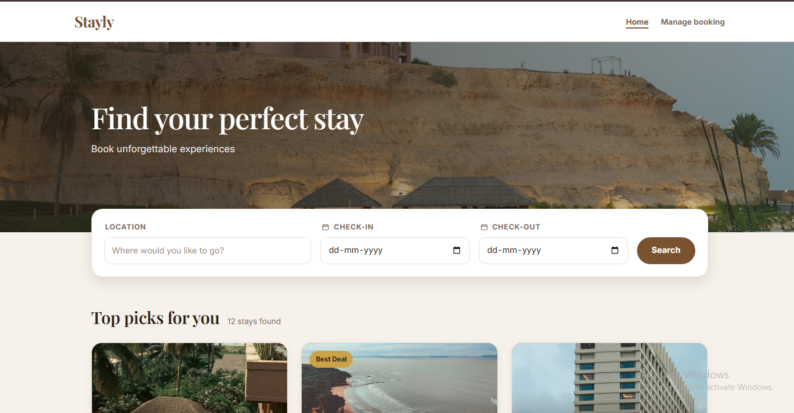
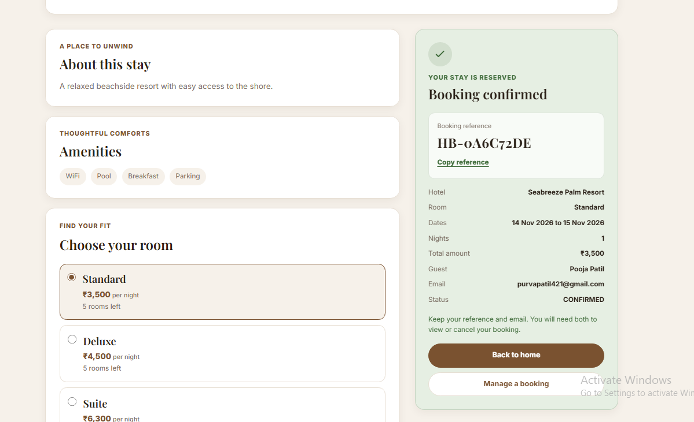
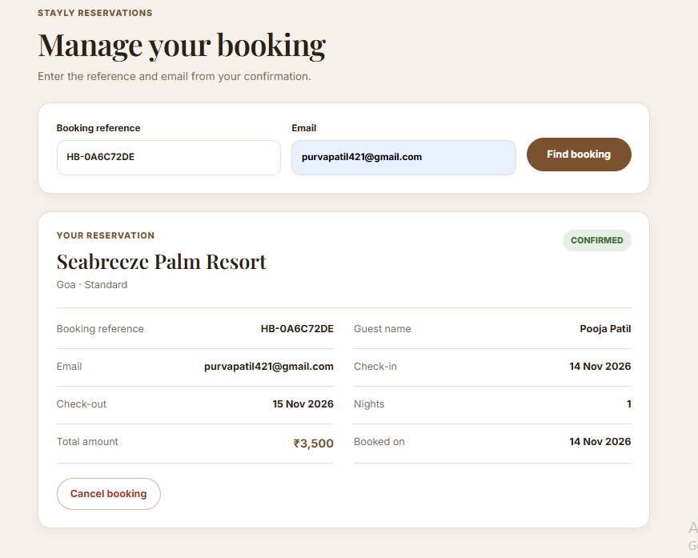
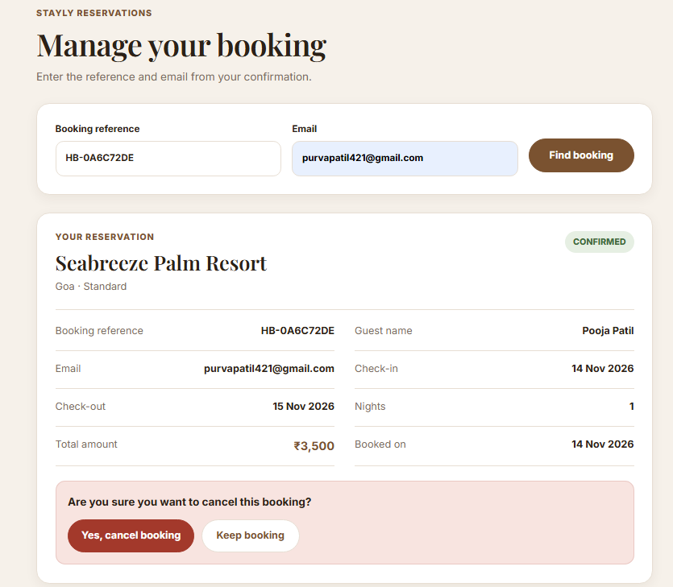
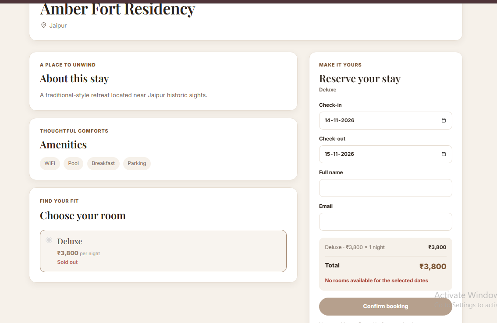

# Hotel Booking Portal

I built a hotel search and booking application for 12 Indian hotels.
The React frontend calls a Spring Boot API, which stores hotel rooms and bookings in MySQL.

## Features

- Search hotels by location and dates.
- View hotel details, photos, amenities, room types, prices, and availability.
- Get a backend price quote before confirming a booking.
- Book one selected room type and receive a booking reference.
- Look up and cancel a booking using its reference and email.
- See the Best Deal badge on the lowest-priced available hotel.
- Check whether the backend is running with a health endpoint.

## Tech stack

- Java 17 and Spring Boot 4.1.2.
- Spring Data JPA, Spring MVC, and Bean Validation.
- MySQL 8 for the application database and H2 for repository tests.
- React 19, React Router 7, Axios, and Vite 8.

## Prerequisites

- JDK 17 or newer. The backend targets Java 17. Check with `java -version`.
- Node.js 20.19 or newer, or 22.12 or newer, plus npm. The Vite 8 version in the lockfile does not support Node 18. Check with `node --version` and `npm --version`.
- Docker with Docker Engine running. Check with `docker --version`.
- Maven is not needed because I use the Maven Wrapper (`mvnw.cmd`).

## Database setup

From the project root, start MySQL 8 in Docker. Replace `YourPassword` with a local password; do not commit it.

```cmd
docker run --name hotel-mysql -e MYSQL_ROOT_PASSWORD=YourPassword -e MYSQL_DATABASE=hotel_booking -p 3306:3306 -d mysql:8.0
```

Wait for MySQL to respond:

```cmd
docker exec hotel-mysql mysqladmin ping -h 127.0.0.1 -uroot -pYourPassword
```

For a fresh database, run the schema first and the sample data second, from the project root:

```cmd
docker exec -i hotel-mysql mysql -uroot -pYourPassword hotel_booking < database\schema.sql
docker exec -i hotel-mysql mysql -uroot -pYourPassword hotel_booking < database\data.sql
```

`schema.sql` creates the tables. It also drops any existing tables, so these commands reset the database and remove existing bookings. `data.sql` inserts the 12 hotels and their room types.

The migration scripts are only for older databases. For a database with the original six hotels and no `image_url` column or later six hotels, run `migration_add_images_and_hotels.sql` once, then `migration_add_room_types.sql`:

```cmd
docker exec -i hotel-mysql mysql -uroot -pYourPassword hotel_booking < database\migration_add_images_and_hotels.sql
docker exec -i hotel-mysql mysql -uroot -pYourPassword hotel_booking < database\migration_add_room_types.sql
```

If the image and hotel migration is already applied, run only the room-type migration if it has not yet been applied. Do not run the image and hotel migration a second time.

## Environment variables

The backend reads `DB_USER` and `DB_PASSWORD` from the environment. I set them in the same Windows Command Prompt window that I use to start the backend. The database URL is `jdbc:mysql://localhost:3306/hotel_booking`.

There is no `frontend/.env.example` in this project. The frontend API base URL is currently set to `http://localhost:8080/api` in `frontend/src/api/api.js`, so no frontend environment file is needed.

## Running the application

Start the backend from a Command Prompt window:

```cmd
cd backend
set DB_USER=root
set DB_PASSWORD=YourPassword
mvnw.cmd spring-boot:run
```

The backend is ready when the log includes `HikariPool-1 - Start completed` and `Started HotelbookingApplication`.

In a second Command Prompt window, install and start the frontend:

```cmd
cd frontend
npm install
npm run dev
```

Open <http://localhost:5173>. The API listens on port 8080.

## Running the tests

From a Command Prompt window:

```cmd
cd backend
mvnw.cmd test
```

The tests do not need MySQL or the `DB_USER` and `DB_PASSWORD` variables. The repository query tests use an in-memory H2 database; the service and date tests use JUnit 5 and Mockito.

## API overview

All API paths are under `/api`. Error responses contain `status`, `error`, `message`, and `timestamp`.

| Method | Path | Purpose | Main error codes |
|---|---|---|---|
| `GET` | `/api/health` | Check that the backend is running. | — |
| `GET` | `/api/hotels?location=&checkIn=&checkOut=` | Search hotels and show date-based room availability. | 400 for invalid or incomplete dates. |
| `GET` | `/api/hotels/{id}?checkIn=&checkOut=` | Get hotel details and room availability. | 400 for invalid dates; 404 if the hotel is unknown. |
| `POST` | `/api/bookings/quote` | Get a price quote for a selected room and date range. | 400 for invalid request or dates; 404 if the room is unknown. |
| `POST` | `/api/bookings` | Create a booking for one selected room. Returns 201 on success. | 400 for invalid request or dates; 404 if the room is unknown; 409 if no rooms are available. |
| `GET` | `/api/bookings/{ref}?email=` | Find a booking using its reference and email. | 400 if email is missing; 404 if the reference and email do not match a booking. |
| `PUT` | `/api/bookings/{ref}/cancel?email=` | Cancel a booking using its reference and email. | 400 if already cancelled or check-in has passed; 404 if the reference and email do not match a booking. |

## Surprise feature: Best Deal badge

I added the badge to make a low-priced available hotel easier to notice while searching. The backend marks every available hotel whose starting price is tied for the lowest starting price among available hotels; a hotel's starting price is its lowest available room price for the selected dates.

## Screenshots

I keep the screenshots in `README/docs/`:











## Project structure

```text
backend/                 Spring Boot API and automated tests
database/                Schema, sample data, and upgrade scripts
frontend/                React and Vite application
README/docs/              Screenshots
README.md                 Setup and project notes
DESIGN.md                 Design decisions
```

## Time spent

Approximate time spent: [FILL IN: hours]

## AI tools disclosure

[FILL IN: I will describe which AI tools I used and for what]

## Known limitations and unfinished items

- There is no login, payment processing, or admin interface.
- Each booking is for one selected room type and one room ID.

Unfinished items: [FILL IN]
